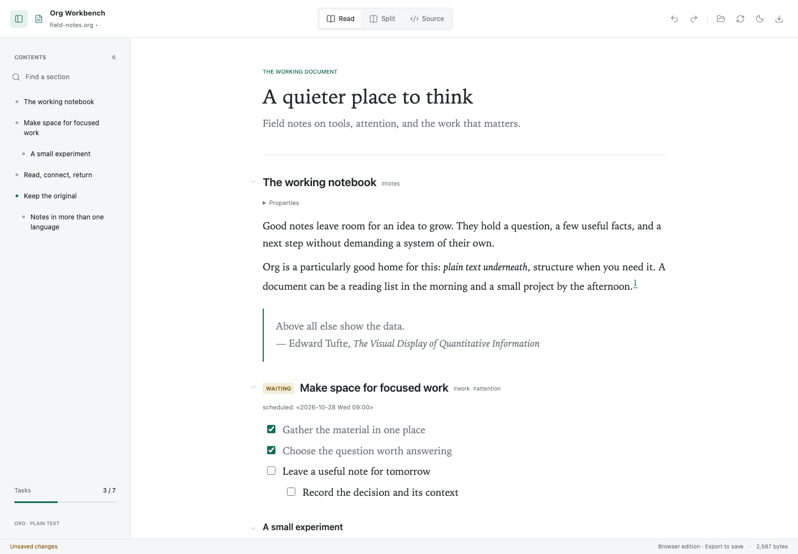
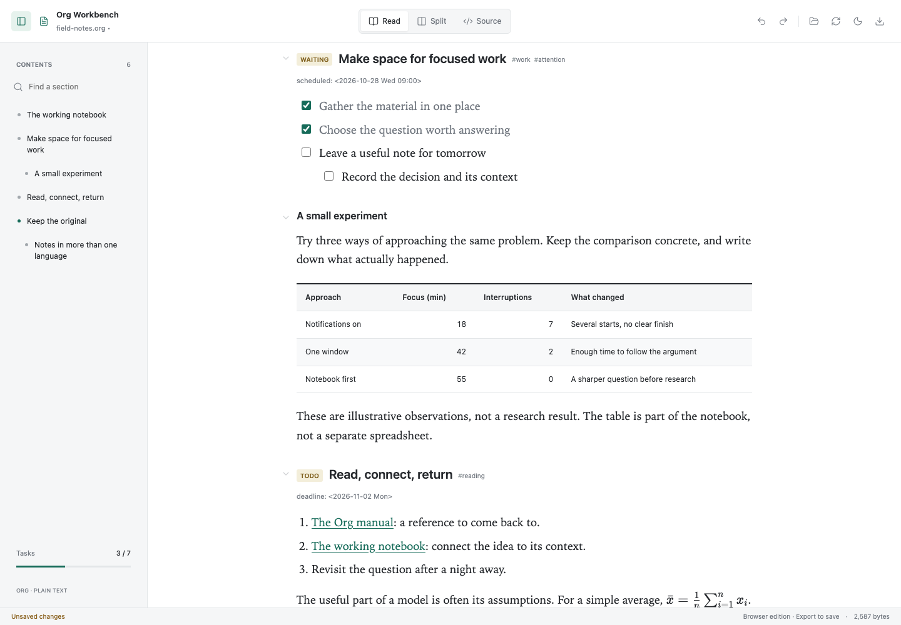

# Org Workbench

**An Org document should be easy to read without becoming difficult to keep.**

Org Workbench is a local, open-source viewer **and editor** for `.org` files.
It opens inside Codex through the MCP Apps file-handler API, and also runs as a
standalone browser editor. No Emacs installation, cloud service, account, or API
key is needed. Your original Org file remains the source of truth.



## What works

- **Read, Split, Source.** Book-like typography for prose, a searchable folding
  outline, and a CodeMirror source editor with Org highlighting and search.
- **Real edits.** Click a TODO badge to cycle its states, click a checkbox,
  or click a table cell to edit it. Double-click prose to jump to its source.
- **Tables worth reading.** Compact text, aligned numeric values, restrained
  rules, sticky headers, wrapping, and contained horizontal scrolling.
- **One undo history.** Source edits and rendered interactions undo together.
- **Careful saves.** Desktop saves use the host's ETag/version check. External
  edits refresh a clean document, but never silently replace unsaved work.
- **Org, not a Markdown conversion.** Tags, priorities, planning dates,
  collapsible properties, links, footnotes, code, and KaTeX math.
- **Light and dark.** Responsive layouts, keyboard navigation, reduced-motion
  support, and a print stylesheet.

This is an early **0.1 community release**, not a replacement for Org's agenda,
capture, Babel, or Emacs. See [compatibility](docs/compatibility.org) for exact
limits and [design.md](design.md) for the architecture.



## Install in Codex Desktop

Requirements: Node.js 22+, npm, Git, and a current Codex CLI/Desktop with local
plugins and MCP file-extension handlers. File handlers are a **desktop** feature.

```sh
git clone https://github.com/guibor/org-workbench.git
cd org-workbench
npm ci
npm run install:codex
```

The installer builds a small, self-contained package in `release/`, registers
its marketplace, and installs `org-workbench@org-workbench-community`. Keep the
checkout if you want to rebuild and update it. It does not change your Emacs
configuration or register global filesystem access.

**After installing, restart Codex or use a fresh chat that loads the plugin.**
An already-running chat can discover the file handler before loading its MCP
server, producing `Couldn't display Org Workbench` / `unknown MCP server
'org-workbench'`. This is distinct from a renderer error. If needed, select
**Org Workbench** using `@` in the new chat.

Open a `.org` file in Codex's file panel, or ask Codex to open it. Start with
[`examples/field-notes.org`](examples/field-notes.org).

For prebuilt packages, extract the release archive, then run from its root:

```sh
codex plugin marketplace add .
codex plugin add org-workbench@org-workbench-community
```

Node.js must be visible to Codex's process environment. Source installation needs
npm; the prebuilt plugin has its dependencies bundled and only needs Node.

## Use it

| Action | Control |
| --- | --- |
| Switch between rendered document and source | Read / Split / Source |
| Edit a task or checkbox | Click it in Read or Split |
| Edit a table cell | Click, or focus it and press Enter |
| Edit arbitrary Org text | Source, or double-click a paragraph |
| Navigate | Contents sidebar; filter by heading text, tag, or task state |
| Follow source selection in Split | Chain-link toggle |
| Undo / redo | Toolbar or Cmd/Ctrl+Z and Cmd/Ctrl+Shift+Z |
| Find text in Source | Cmd/Ctrl+F |
| Save original file | Save or Cmd/Ctrl+S, when host writes are available |
| Export current edits | Download copy |
| Reload external changes | Reload button; confirms before discarding edits |

Edits are **not autosaved**. Save before closing the file panel; an iframe close
may not show a browser unsaved-changes prompt. Read-only hosts still allow
in-memory editing and export, but never pretend to save the original file.
Changes to TODO states and checkboxes do not run Org hooks, update statistics
cookies, log timestamps, or change dependent tasks.

## Browser Edition

```sh
npm run dev
```

Open the localhost URL. Use the folder button to import any `.org` file.
The browser edition edits in memory and exports a downloaded `.org` copy;
it **does not overwrite** the imported file. Files are not uploaded or persisted
in browser storage. Relative images/file links require the desktop file handler.

`npm run build` also produces a self-contained `dist/ui/index.html`.

## Safety and Privacy

No telemetry, AI calls, automatic remote images, or document uploads. Raw HTML
is displayed as inert text. Babel, includes, setup files, file-local variables,
and table formulas are never executed. Only explicitly selected, contained
raster images are read. Local links resolve inside the opened document's folder,
including symlink containment checks. Writes go through the host, not an
unrestricted server write tool. See [SECURITY.md](SECURITY.md).

## Development

```sh
npm ci
npm run build
npm test
npx playwright install chromium
npm run test:e2e
```

Tests cover exact source edits, Unicode and CRLF, hostile HTML, stale versions,
save races, path traversal, the bundled stdio server, desktop/mobile interactions,
and a mock MCP host with read/write/change notifications. Mock-host tests do
not substitute for testing the installed plugin in a real desktop host.

Contributions welcome: [CONTRIBUTING.md](CONTRIBUTING.md),
[requirements and next steps](prd.org), [design](design.md).

## Credits and License

Built on [Uniorg](https://github.com/rasendubi/uniorg),
[CodeMirror](https://codemirror.net/), React, KaTeX, Lucide, and the official
[MCP Apps](https://github.com/modelcontextprotocol/ext-apps) and
[OpenAI MCP Extensions](https://github.com/openai/mcp-extensions) SDKs.
GitHub and GitLab's rendered/source document views inspired the interaction;
this project is not affiliated with those services or OpenAI.

GPL-3.0-or-later, consistent with Uniorg's license. See [LICENSE](LICENSE) and
[NOTICE](NOTICE). Bundled dependency notices ship in
`dist/THIRD_PARTY_LICENSES.txt`.
