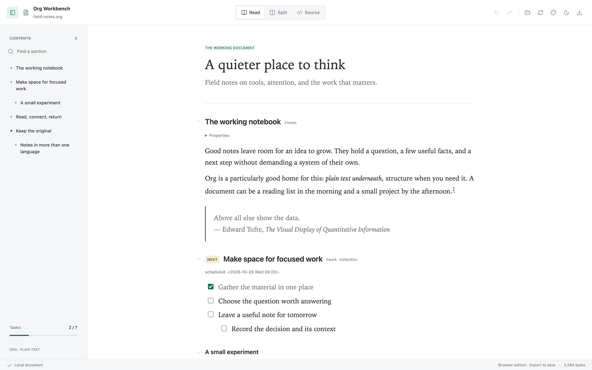
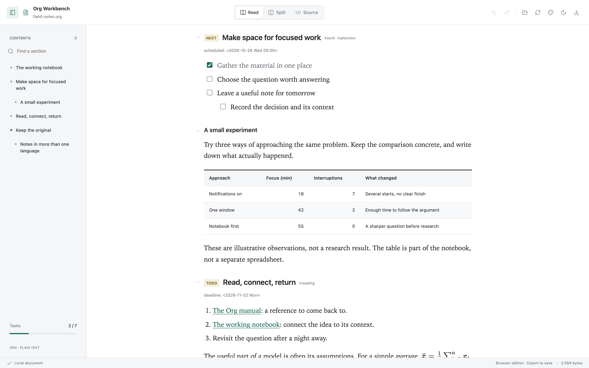
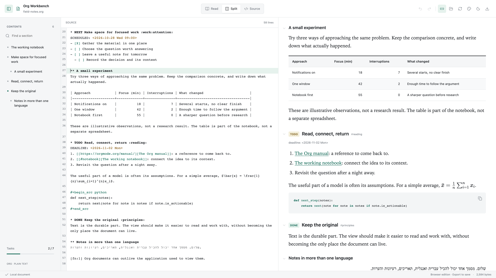
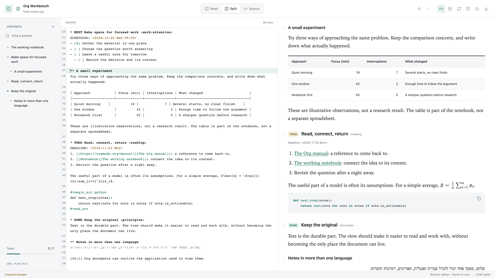
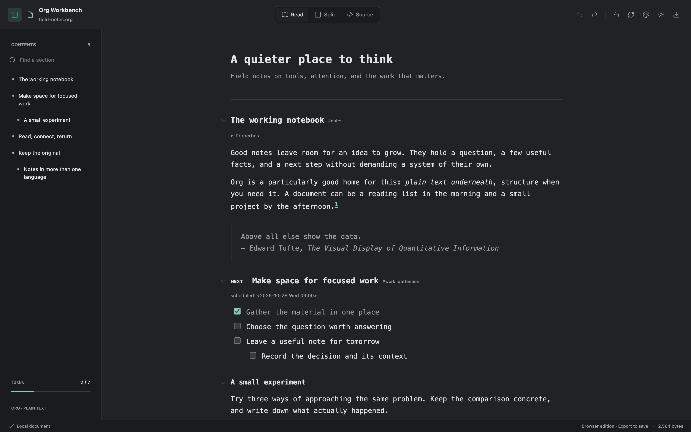
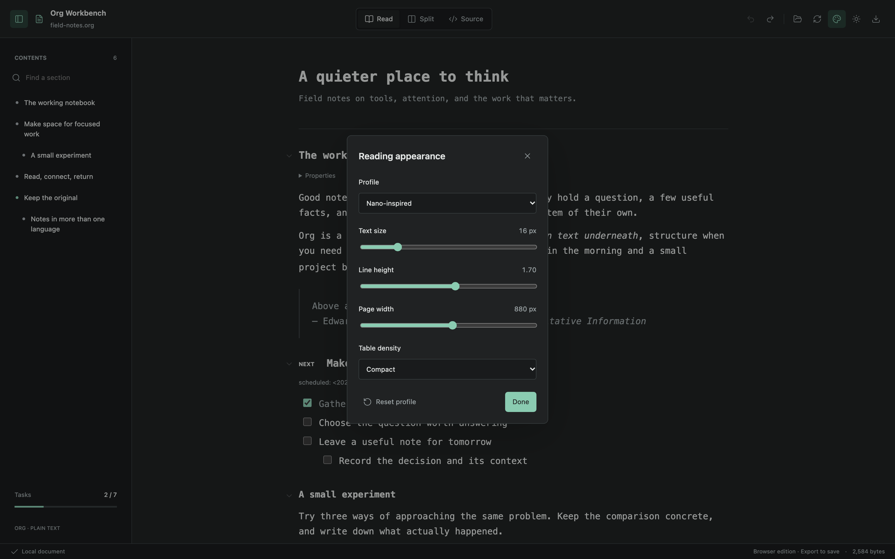

# Org Workbench Screenshots

Org Workbench is a Codex file-viewer plugin. These screenshots show its actual
interface using the public `examples/field-notes.org` fixture. They were captured
from the browser demo, which uses the same React renderer as the plugin;
they are not full Codex application screenshots. No host chrome or save state
has been composited into them.

## Reading

## Tasks and Tables

## Source and Rendered Document

## Editing the Same Source

## Nano-Inspired Dark Profile

## Reading Controls

Captions, alt text, dimensions, and SHA-256 hashes are in
[`screenshots/manifest.json`](screenshots/manifest.json).
To regenerate while a local preview is running: `npm run screenshots`.
